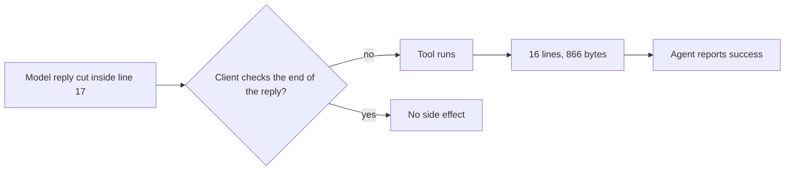

## The 866-Byte File

The model was asked to write a 40-line file. Its reply stopped in the middle of line 17. The client ran the tool anyway. The file on disk held 16 lines and 866 bytes; the expected file was 2,120 bytes. Nothing raised. The agent reported success.

That file is the evidence. A log line can be missing, and a self-report can be wrong. The bytes on disk are what happened.

The property under test is a contract between three parts: the model emits a tool call, the client decides whether the call is complete, and the tool executes. The model did its job badly. The client's job was to notice.

## Where Reliability Lives

Most agent benchmarks measure task success<d-cite key="swebench"></d-cite>. Did the agent book the flight, or fix the bug? That is useful. It is also an average over a hundred small decisions, including the ones that should never have been made. A success rate cannot tell you whether a client checks the end of a stream, or whether a JSON parser happened to reject a truncated payload.

Those two cases produce the same score. A client that checks the finish reason and a client that gets lucky with a parser both show no side effect. One has a guard. The other has a coincidence that disappears when the payload changes.

We built a small conformance suite around that distinction. It has a fake model that speaks the OpenAI wire formats<d-cite key="openai_chat,openai_responses"></d-cite> and records the exact bytes it sends. It has a tool that writes a file, so the side effect is attributable. The expected values are written before the run and read from a git ref, not the working tree.

## What a Pass Has to Prove

The suite judges four fields per cell: whether a call reached the tool, the number of lines in the file, the byte count, and the sha256. All four have to match, on all three runs. A cell whose runs disagree is reported as unstable, not as a pass.

This sounds fussy until it catches something. Early on, a judgement compared only whether a call executed. One cell looked clean. The byte count showed a short file. The run had executed, the file was wrong, and the check had missed it because it asked a smaller question than the claim.

The same logic applies to a not-executed result. Not executing can be skill or luck. The client may have checked that the reply had finished. A parser may have rejected the payload before the client had a chance to be wrong. Or the record may not tell us which. We label the first blocked-by-end-signal, the second blocked-by-parse, and the rest unknown. A label needs evidence: blocked-by-parse is only written when the captured client log contains the parse error. Otherwise the cell is unknown, and unknown is not a pass.

The control that separates the two is boring and effective. Send the same truncated payload with a normal end signal. If the control executes and the truncated variant does not, the client checked the end signal. If neither executes, the parser did the work. Only the end signal differed.

## Nine Ways the Measurement Lied

The most useful output was the list of ways the measurement produced a confident wrong answer. Some were caught before a run, some after. Each one is now a rule.

| What happened | Why it is dangerous | Rule now |
|---|---|---|
| Judged only whether a call executed | Reported a false all-pass; a human noticed the byte count | Compare all four fields |
| Pre-registration and results in one commit | The repository cannot prove the rules came first | Three commits, rules pushed first |
| Top-level packages pinned, transitive dependencies floating | Another machine resolves a different tree | Lock file with hashes |
| Evidence read as text on a CRLF checkout | Every file differs by one byte per line | Mark evidence binary |
| Results path overwritten before comparing | The run is compared to a baseline it just replaced | Runner refuses to overwrite; expected values from a git ref |
| A stimulus whose execution leaves nothing on disk | Executed and not executed become indistinguishable | Ask where the trace is before running |
| A label written from the design, not the evidence | Assumption dressed as measurement | A label without evidence is unknown |
| "Any of three runs" used to summarize | Turns n=3 into n=1 | Require all three |
| A truncated stimulus repeated on every request | One execution counted twice | State what later requests answer |

The first false pass came from a check that asked only whether a call reached the tool. It did. A human noticed the byte count. A check that stops at "did it run" cannot see a short file, so the suite now compares the line count, the byte count, and the hash as well.

The git ref fixes a subtler problem. If the expected values sit in the working tree, a run can write its results over the baseline before the comparison, and the benchmark ends up measuring its own output. The runner now refuses to overwrite an existing results file, and the expected values are read from a git ref.

The label from the design is the one that feels most like progress and is most dangerous. A payload that looks like broken JSON invites the label blocked-by-parse. Without the captured parse error, that label is a guess. The rule is to write unknown and leave it there until a log proves otherwise.

## What the Cross-Framework Run Showed

We ran one case across three frameworks and four entry points, each at the entry its quickstart demonstrates<d-cite key="langchain_agents,semantic_kernel,nemo_toolkit"></d-cite>. The table is small on purpose.

Each column is a way for the reply to end. `chat-length` (Chat Completions) stops at the token limit with `finish_reason: length` and a `[DONE]` marker; `chat-drop` (Chat Completions) ends with no finish reason and no `[DONE]`. `responses-incomplete` (Responses) returns `response.incomplete` from the output-token limit, and `responses-drop` (Responses) ends before `response.completed`. All four cut the tool call at the same point.

| Client | Version | chat-length | chat-drop | responses-* |
|---|---|---|---|---|
| NeMo Agent Toolkit, tool_calling_agent | 1.9.0 | not executed (unknown) | executed, 16/40, 866 B | executed |
| NeMo Agent Toolkit, react_agent | 1.9.0 | executed | executed | executed |
| LangChain, create_agent | 1.4.9 | not executed (unknown) | not executed (unknown) | not measurable |
| Semantic Kernel, automatic function calling | 1.36.0 | not executed (unknown) | not executed (unknown) | not measurable |

The NeMo rows were measured on 1.9.0; later versions may differ. The LangChain and Semantic Kernel rows are first measurements in this suite. None of the not-executed cells could be attributed to an end-signal check; all of them are unknown. The labels are there so a later run can fill them. That is the finding: a summary table would show these cells as passes, and the table cannot tell you which client has a guard.

The not-measurable cells are also a result. The client never requested the endpoint the variant needs, so the cell is excluded from the denominator. Counting it as a pass would inflate the score with a test that never ran.

## What This Changes

Report the mechanism. A verdict without a reason is not a safety claim. If the client did not execute, say whether it checked the end signal, a parser rejected the payload, or you do not know.

Keep the standard out of the run's reach. Write the expected values first, push them, and read them from a ref. If the run can edit the expected file, the benchmark is measuring the run's opinion of itself.

Use a control that differs in one variable. Otherwise "no side effect" is ambiguous, and ambiguity will be read as a pass by everyone who wants one.

## Limits

The fake server models the wire format, not a provider's behavior. It shows what a client does with a given reply; it says nothing about how often that reply occurs in production. The suite covers default paths only, one tool, one cut point per variant, three runs per cell. It is a conformance check, not a ranking. The sample is small, and the claims are about the method.

The artifact is a template as much as a benchmark. The nine failures of method are the part worth copying.

## The Point

A pass becomes a guard only when you can say why it passed. The 866-byte file is what a missing guard looks like: no exception, no warning, a confident success message, and a file that is missing 1,254 bytes.

If you take one thing from this, measure the side effect, write the standard before the run, and say why a cell passed. The rest is bookkeeping: lock files, binary evidence, three runs, a git ref.
